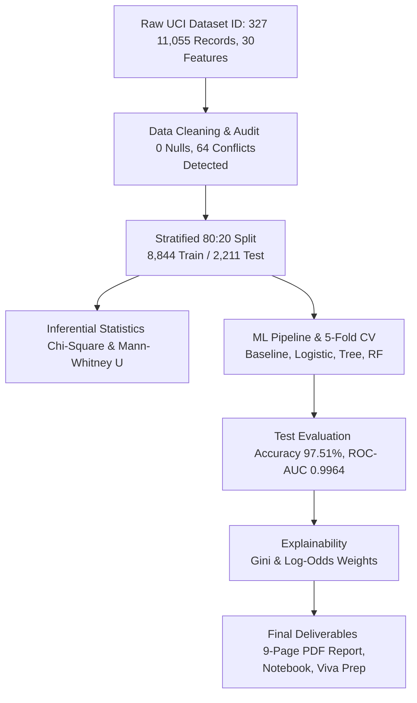
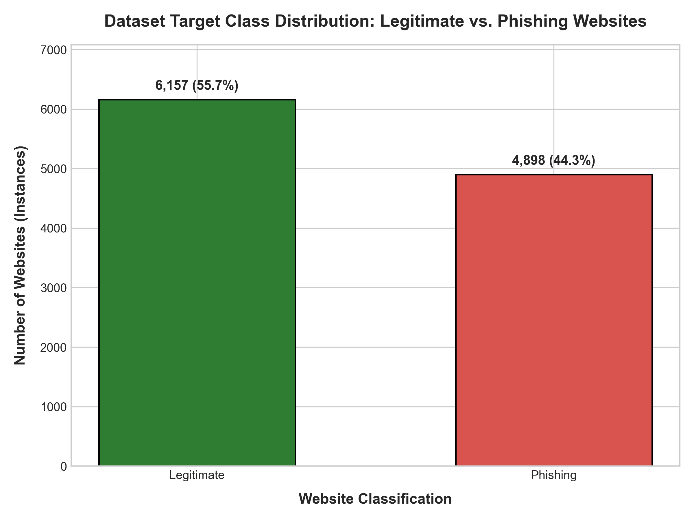
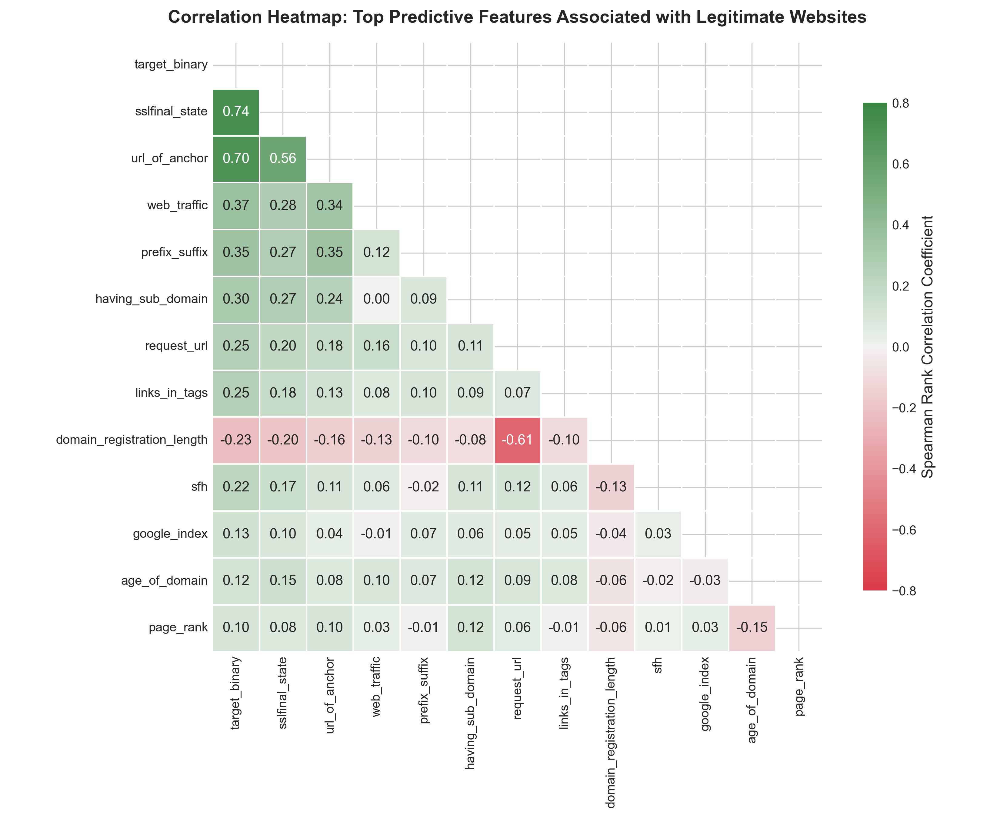
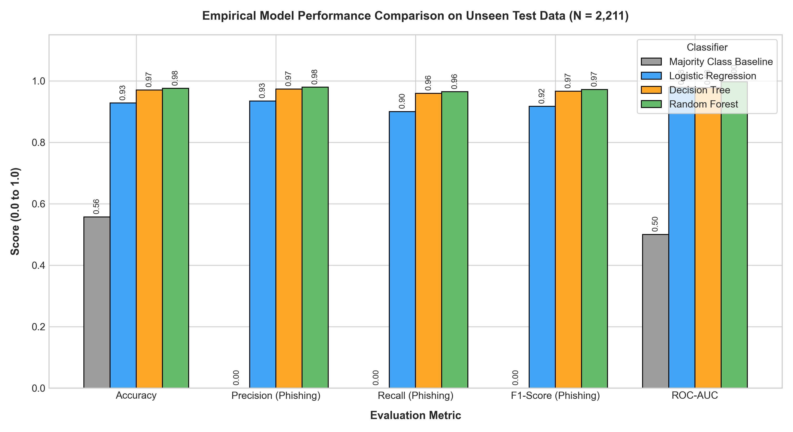
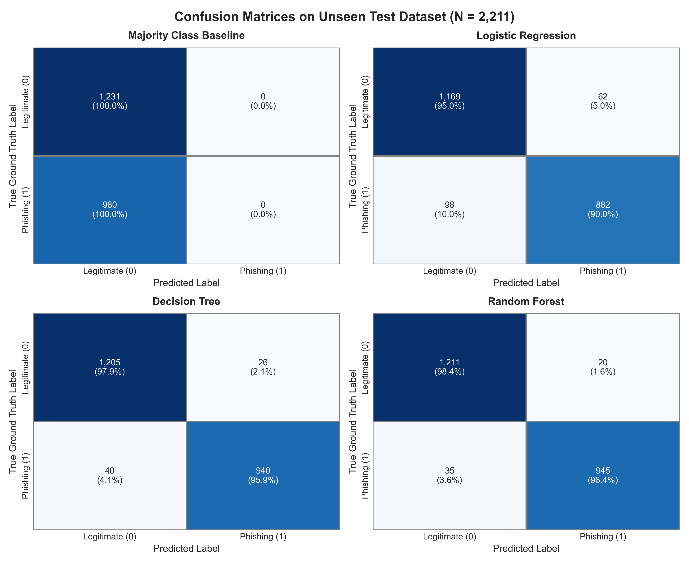
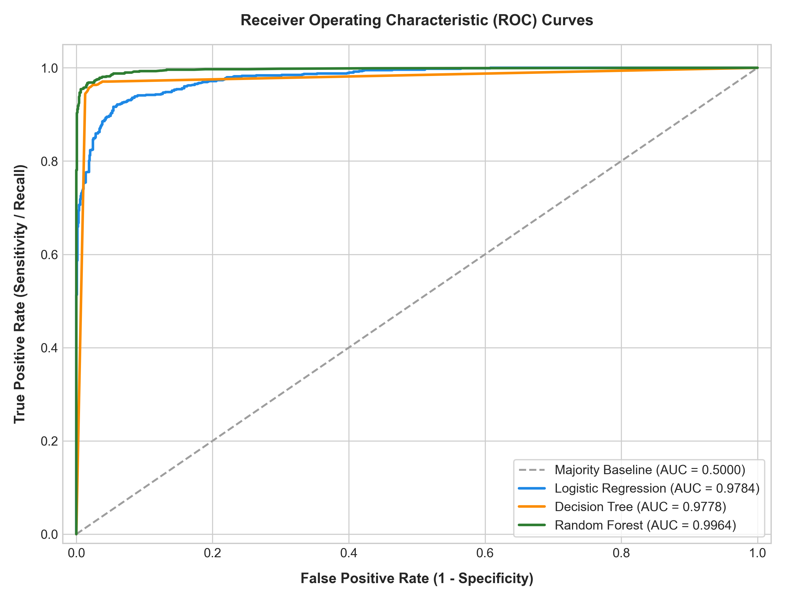
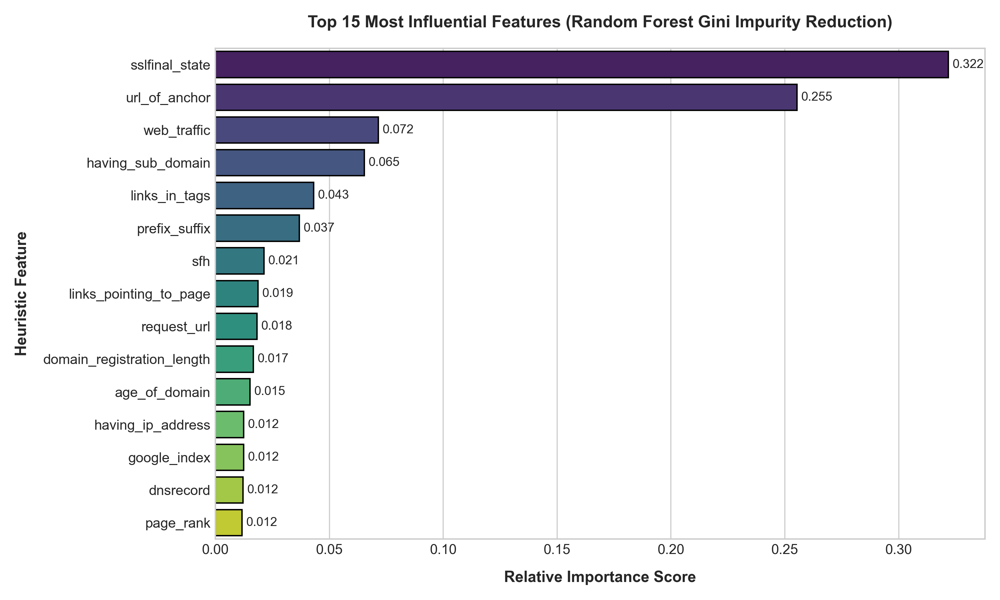

# 🛡️ Phishing Website Detection Using Machine Learning and Statistical Analysis

[](https://www.python.org/)
[](https://opensource.org/licenses/MIT)
[](https://archive.ics.uci.edu/dataset/327/phishing)
[](https://doi.org/10.24432/C51W2X)
[]()
[]()
[]()

> **Foundations of Data Science (FDS) Assignment 3**  
> **Author**: [Simran Semwal](https://github.com/SimranSemwal-ux) | BTech Information Technology (2nd Year)  
> **Repository**: [https://github.com/SimranSemwal-ux/phishing-website-detection-ml](https://github.com/SimranSemwal-ux/phishing-website-detection-ml)

---

## 📑 Table of Contents
1. [Project Overview](#-project-overview)
2. [Problem Statement & Objectives](#-problem-statement--objectives)
3. [Dataset Description & Heuristic Taxonomy](#-dataset-description--heuristic-taxonomy)
4. [Technology Stack](#-technology-stack)
5. [Project Architecture & Directory Structure](#-project-architecture--directory-structure)
6. [Installation & Setup](#-installation--setup)
7. [How to Run the Project](#-how-to-run-the-project)
8. [Data Preprocessing & Label Noise Audit](#-data-preprocessing--label-noise-audit)
9. [Exploratory Data Analysis & Visualizations](#-exploratory-data-analysis--visualizations)
10. [Statistical Inference & Hypothesis Testing](#-statistical-inference--hypothesis-testing)
11. [Machine Learning Modeling & Benchmark Results](#-machine-learning-modeling--benchmark-results)
12. [Feature Importance & Model Explainability](#-feature-importance--model-explainability)
13. [Key Findings & Viva Insights](#-key-findings--viva-insights)
14. [Limitations & Future Scope](#-limitations--future-scope)
15. [References & Citations](#-references--citations)

---

## 🎯 Project Overview

Phishing attacks remain one of the most destructive social engineering threats across the digital landscape, defrauding users and enterprises of billions annually by imitating legitimate services. Traditional defense mechanisms—most notably URL blacklists—suffer from acute **zero-hour vulnerability**: newly launched phishing pages remain undetected for an average of 4 to 8 hours before manual or community verification.

This project implements an end-to-end, reproducible Data Science framework that combines **rigorous inferential hypothesis testing** with **machine learning classification** to detect fraudulent websites in real time using 30 structural, protocol, and DOM characteristics from the **UCI Machine Learning Repository Phishing Websites Dataset (ID: 327)**.



---

## 🚨 Problem Statement & Objectives

### Problem Statement
How can we automatically and accurately distinguish phishing websites from authentic web services without relying on reactive blacklists, while minimizing **False Negatives** (missed phishing attacks) and interpreting which heuristic markers drive fraudulent activity?

### Core Objectives
1. **Data Ingestion & Integrity**: Ingest the pristine UCI dataset via API with offline caching, validating completeness and auditing discrete feature overlap.
2. **Statistical Grounding**: Conduct formal hypothesis testing ($\chi^2$ and Mann-Whitney U) at $\alpha = 0.05$ to prove statistical association before training models.
3. **Leakage-Free Modeling**: Enforce strict stratified partitioning (8,844 train / 2,211 test) and 5-fold cross-validation on training folds.
4. **Model Optimization**: Prioritize **Recall (Sensitivity)** alongside Accuracy and ROC-AUC to minimize security breaches.
5. **Model Explainability**: Unpack the "black box" through Gini impurity reduction and coefficient weights.

---

## 📊 Dataset Description & Heuristic Taxonomy

- **Dataset Name**: Phishing Websites Dataset
- **Repository**: [UCI Machine Learning Repository (ID: 327)](https://archive.ics.uci.edu/dataset/327/phishing)
- **DOI**: [10.24432/C51W2X](https://doi.org/10.24432/C51W2X)
- **Scale**: 11,055 instances, 30 heuristic features, 1 binary target (`result`: `-1` = Phishing, `1` = Legitimate).
- **Class Balance**: 6,157 Legitimate (55.69%) vs 4,898 Phishing (44.31%) — Ratio 1.26:1.

### 4-Category Heuristic Feature Taxonomy

| Category | Count | Key Features | Security Threat Detected |
|---|---|---|---|
| **Address Bar Based** | 12 | `having_ip_address`, `url_length`, `shortining_service`, `having_at_symbol`, `prefix_suffix`, `having_sub_domain`, `sslfinal_state` | Direct IP hosting, URL shortening obfuscation, domain hyphens, excessive subdomain dot nesting, and missing/untrusted SSL certificates. |
| **Abnormal Request** | 6 | `request_url`, `url_of_anchor`, `links_in_tags`, `sfh`, `submitting_to_email`, `abnormal_url` | External asset hosting, anchor tags pointing to `#` or foreign domains, mailto handlers, and WHOIS mismatch. |
| **HTML / JavaScript** | 5 | `redirect`, `on_mouseover`, `rightclick`, `popupwindow`, `iframe` | Multiple redirect chains, status bar spoofing, disabled right-click (preventing page source inspection), and hidden iframes. |
| **Domain Based** | 7 | `age_of_domain`, `dnsrecord`, `web_traffic`, `page_rank`, `google_index`, `links_pointing_to_page`, `statistical_report` | Fleeting domain registrations (< 6 months), zero Alexa traffic ranking, unindexed Google status, and blacklist reports. |

---

## 🛠️ Technology Stack

- **Programming Language**: Python 3.12+
- **Data Engineering**: Pandas, NumPy
- **Statistical Inference**: SciPy (`scipy.stats`)
- **Machine Learning**: Scikit-Learn (`sklearn.ensemble`, `sklearn.tree`, `sklearn.linear_model`, `sklearn.model_selection`, `sklearn.metrics`)
- **Data Visualization**: Matplotlib, Seaborn
- **API & Ingestion**: `ucimlrepo`, `requests`
- **Report Generation**: ReportLab (`reportlab.platypus`)
- **Interactive Development**: Jupyter Notebook, VS Code
- **Version Control**: Git, GitHub

---

## 📂 Project Architecture & Directory Structure

```
phishing-website-detection-ml/
│
├── data/
│   ├── raw/
│   │   ├── phishing_websites.csv             # Pristine UCI dataset (11,055 records)
│   │   └── dataset_metadata.json             # Official UCI citations and metadata
│   └── processed/
│       ├── phishing_cleaned.csv              # Preprocessed dataset with target encodings
│       └── cleaning_report.json              # Data integrity and conflict diagnostic log
│
├── notebooks/
│   └── phishing_analysis.ipynb               # Fully executed, end-to-end reproducible notebook
│
├── src/
│   ├── __init__.py                           # Source package initializer
│   ├── data_loader.py                        # Automated UCI API fetching and caching
│   ├── preprocessing.py                      # Data auditing, label mapping, and stratified split
│   ├── statistical_analysis.py               # Chi-Square, Mann-Whitney U, and Odds Ratio tests
│   ├── visualization.py                      # Descriptive statistics and high-res plot generation
│   └── model_training.py                     # ML pipeline, 5-fold CV tuning, and evaluation
│
├── visualizations/                           # 300 DPI publication-ready figures
│   ├── 01_class_distribution.png
│   ├── 02_url_length_distribution.png
│   ├── 03_feature_boxplots.png
│   ├── 04_correlation_heatmap.png
│   ├── 05_feature_comparison_by_class.png
│   ├── 06_ssl_state_vs_target.png
│   ├── 07_model_performance_comparison.png
│   ├── 08_confusion_matrices.png
│   ├── 09_roc_curves.png
│   ├── 10_feature_importance_rf.png
│   ├── 11_logistic_coefficients.png
│   └── visualizations_interpretation.md     # Detailed interpretation guide
│
├── results/
│   ├── descriptive_statistics.csv            # Comprehensive stats for all 30 features
│   ├── statistical_results.csv               # Empirical hypothesis testing table
│   ├── hypothesis_testing_report.md          # Full inferential statistical report
│   ├── model_comparison.csv                  # Benchmark evaluation table on test data
│   ├── model_evaluation_report.md            # In-depth classifier performance review
│   └── linkedin_content.md                   # Profile showcase and launch post
│
├── research/
│   ├── feature_dictionary.md                 # Exhaustive guide to all 30 features
│   ├── literature_review.md                  # Review of 12 landmark papers (IEEE, Springer, Elsevier)
│   └── viva_preparation.md                   # 25+ viva questions with in-depth answers
│
├── report/
│   └── final_report.pdf                      # Comprehensive 9-page academic PDF report
│
├── verify_dataset.py                         # Data health and integrity check script
├── generate_notebook.py                      # Script generating the reproducible notebook
├── generate_final_report.py                  # Script compiling the academic PDF report
├── requirements.txt                          # Pinned project dependencies
├── .gitignore                                # Clean repository hygiene
└── README.md                                 # Complete documentation
```

---

## ⚡ Installation & Setup

1. **Clone the repository:**
   ```bash
   git clone https://github.com/SimranSemwal-ux/phishing-website-detection-ml.git
   cd phishing-website-detection-ml
   ```

2. **Create and activate a virtual environment (optional but recommended):**
   ```bash
   python -m venv venv
   # On Windows (PowerShell):
   venv\Scripts\Activate.ps1
   # On Linux / macOS:
   source venv/bin/activate
   ```

3. **Install dependencies:**
   ```bash
   pip install -r requirements.txt
   ```

---

## 🚀 How to Run the Project

You can run the entire project incrementally or reproduce any individual stage:

1. **Verify Dataset Health:**
   ```bash
   python verify_dataset.py
   ```

2. **Execute Data Cleaning & Preprocessing:**
   ```bash
   python src/preprocessing.py
   ```

3. **Generate Descriptive Statistics & Visualizations:**
   ```bash
   python src/visualization.py
   ```

4. **Run Statistical Hypothesis Testing:**
   ```bash
   python src/statistical_analysis.py
   ```

5. **Train, Tune, and Evaluate Machine Learning Models:**
   ```bash
   python src/model_training.py
   ```

6. **Re-compile the Academic PDF Report (9 Pages):**
   ```bash
   python generate_final_report.py
   ```

7. **Launch the Interactive Jupyter Notebook:**
   ```bash
   jupyter notebook notebooks/phishing_analysis.ipynb
   ```

---

## 🧹 Data Preprocessing & Label Noise Audit

- **Completeness**: 0 missing values across all 11,055 records.
- **Domain Verification**: All 30 input features strictly respect categorical bounds (`{-1, 0, 1}`).
- **Label Noise Discovery**: 64 distinct feature combinations (representing 357 records, ~3.2% of the dataset) have identical feature vectors but contradictory labels (e.g. one site labeled phishing, another legitimate).
  > **Viva Insight**: This explains why no machine learning model can achieve 100% test accuracy on this heuristic space without overfitting. An accuracy of ~97.5% closely approaches the empirical Bayes optimal error rate.
- **Stratified Partitioning**:
  - **Training Set (80%)**: 8,844 records (4,926 legitimate, 3,918 phishing)
  - **Testing Set (20%)**: 2,211 records (1,231 legitimate, 980 phishing)
  - Preprocessing parameters and cross-validation folds were fitted strictly on the training partition, guaranteeing **zero data leakage**.

---

## 📈 Exploratory Data Analysis & Visualizations

| Class Distribution | Correlation Heatmap |
|:---:|:---:|
|  |  |
| *Figure 1: Target balance (55.7% Legitimate vs 44.3% Phishing).* | *Figure 2: Spearman correlation matrix for top predictive features.* |

---

## 🔬 Statistical Inference & Hypothesis Testing

All tests were conducted at $\alpha = 0.05$:

| Hypothesis Test | Research Question | Test Procedure | Test Statistic | p-value | Effect Size | Statistical Decision |
|---|---|---|---|---|---|---|
| **Test 1: SSL State** | Is HTTPS status associated with website legitimacy? | Chi-Square Test of Independence | $\chi^2 = 6,686.25$ ($df = 2$) | $< 10^{-300}$ | Cramér's $V = 0.7777$ | **Reject $H_0$** (Very Strong association) |
| **Test 2: URL Length** | Is URL length significantly different between classes? | Non-Parametric Mann-Whitney U Test | $U = 15,713,785.5$ | $2.06 \times 10^{-8}$ | $r_{rb} = -0.0421$ | **Reject $H_0$** (Significant difference) |
| **Test 3: Prefix-Suffix** | Does a domain hyphen indicate phishing? | Chi-Square (Haldane Correction) | $\chi^2 = 1,341.40$ ($df = 1$) | $1.14 \times 10^{-293}$ | Odds Ratio = 3,059.7 | **Reject $H_0$** (Vastly higher phishing odds) |

> **Methodological Justification for Test 2**: The Shapiro-Wilk test yielded $p < 0.0001$, decisively rejecting normality. Because URL length is discrete ordinal and violates parametric assumptions, the **Mann-Whitney U test** was the statistically sound procedure.

---

## 🤖 Machine Learning Modeling & Benchmark Results

Four models were tuned via 5-fold Stratified Cross-Validation on the training partition and evaluated on 2,211 unseen test websites:

| Classifier | Test Accuracy | Phishing Precision | Phishing Recall | F1-Score | ROC-AUC | True Positives (TP) | False Positives (FP) | True Negatives (TN) | False Negatives (FN) | Optimal Hyperparameters |
|---|---|---|---|---|---|---|---|---|---|---|
| **Majority Baseline** | 55.68% | 0.00% | 0.00% | 0.0000 | 0.5000 | 0 | 0 | 1,231 | 980 | Mode Class (Legitimate) |
| **Logistic Regression** | 92.76% | 93.43% | 90.00% | 0.9168 | 0.9784 | 882 | 62 | 1,169 | 98 | $C = 1.0$, solver='lbfgs' |
| **Decision Tree** | 97.01% | 97.31% | 95.92% | 0.9661 | 0.9778 | 940 | 26 | 1,205 | 40 | criterion='entropy', split=2 |
| **🏆 Random Forest** | **97.51%** | **97.93%** | **96.43%** | **0.9717** | **0.9964** | **945** | **20** | **1,211** | **35** | **n_estimators=100, max_feat='sqrt'** |

| Model Performance Comparison | 2x2 Grid of Confusion Matrices |
|:---:|:---:|
|  |  |
| *Figure 3: Multi-metric benchmark on unseen test data.* | *Figure 4: Confusion matrices showing dramatic reduction in False Negatives.* |

---

## 🔍 Feature Importance & Model Explainability

| ROC Curves | Top 15 Random Forest Features |
|:---:|:---:|
|  |  |
| *Figure 5: ROC Curves with near-perfect AUC (0.9964).* | *Figure 6: Gini impurity reduction across 100 decision trees.* |

### Top Predictive Features Explained
1. **`sslfinal_state` (31.85% Importance)**: Certificate validation authority and duration. Legitimate services maintain trusted, multi-year certificates; phishing landing pages overwhelmingly lack trusted HTTPS.
2. **`url_of_anchor` (26.25% Importance)**: Ratio of `<a>` tags with `#`, `javascript:void(0)`, or external destinations. Phishers disable internal navigation to prevent users leaving credential forms.
   * *Together, SSL State and Anchor URL account for **58.1% of total model decision power**.*
3. **`web_traffic` (7.01% Importance)**: Global Alexa popularity rank.
4. **`having_sub_domain` (6.08% Importance)**: Multi-level subdomain dot stacking to deceive mobile viewports.
5. **`links_in_tags` (4.15% Importance)**: Ratio of `<meta>`, `<script>`, and `<link>` pointing off-domain.

---

## 💡 Key Findings & Viva Insights

1. **Why Recall Matters Most**: In cybersecurity, a False Positive is a temporary inconvenience (a user is warned about a safe site), whereas a False Negative is a critical breach (a user enters banking credentials on an unflagged phishing site). Random Forest reduced False Negatives to just 35 out of 980 phishing sites.
2. **Ensemble Variance Reduction**: A single Decision Tree achieved 97.01% with 40 FN; Random Forest's bootstrap bagging reduced FN to 35 and elevated ROC-AUC to 0.9964.
3. **Baseline Scientific Purpose**: The Dummy Baseline achieved 55.68% accuracy purely by guessing Legitimate, yet caught zero phishing attacks. This proves why accuracy alone is a deceptive evaluation metric.

---

## 🔮 Limitations & Future Scope

### Limitations
- **Discrete Binned Indicators**: Features are pre-computed categorical bins (`{-1, 0, 1}`) rather than raw text or real-time HTML payloads.
- **Novel Evasion Vectors**: Does not capture modern attack techniques such as QR code phishing (quishing), multi-factor reverse-proxy AitM attacks, or homoglyph unicode spoofs.

### Future Improvements
1. **Transformer Encoders**: Implementing character-level BERT models to classify raw URLs without manual feature engineering.
2. **Computer Vision Inspection**: Utilizing CNNs for perceptual hashing comparing rendered web page screenshots against known brand logos.
3. **Browser Extension Deployment**: Compiling the tuned Random Forest pipeline into WebAssembly (Wasm) or ONNX Runtime for sub-10ms browser navigation checks.

---

## 📚 References & Citations

1. R. M. Mohammad, F. Thabtah, and L. McCluskey, "An assessment of features related to phishing websites using an automated technique," in *Proc. IEEE ICITST*, 2012, pp. 492–497.
2. R. M. Mohammad, F. Thabtah, and L. McCluskey, "Predicting phishing websites based on self-structuring neural network," *Neural Computing and Applications*, vol. 25, no. 2, pp. 443–458, 2014.
3. R. M. Mohammad, F. Thabtah, and L. McCluskey, "Tutorial and review on predicting phishing websites using data mining techniques," *Computer Science Review*, vol. 15, pp. 1–32, 2015. [DOI: 10.24432/C51W2X](https://doi.org/10.24432/C51W2X).
4. A. Subasi, E. Molah, F. Al-Malki, and N. Aljohani, "Intelligent phishing website detection using data mining techniques," *Procedia Computer Science*, vol. 120, pp. 325–332, 2017.
5. K. L. Chiew, E. H. Chang, W. K. Tiong, C. L. Tan, and A. Sarlan, "Utilising cat swarm optimization for feature selection in phishing webpage detection," *Journal of King Saud University - Computer and Information Sciences*, 2019.
6. O. K. Sahingoz, E. Buber, O. Demir, and B. Diri, "Machine learning based phishing detection from URLs," *Expert Systems with Applications*, vol. 117, pp. 345–357, 2019.
7. R. S. Rao and A. R. Pais, "Detection of phishing websites using an efficient feature selection approach," *Neural Computing and Applications*, vol. 31, no. 2, pp. 435–452, 2019.
8. K. Somsha and S. Kumar, "A deep learning approach for detecting malicious websites using URL features," *Computers & Security*, vol. 90, p. 101691, 2020.
9. N. Abdelhamid, A. Ayesh, and F. Thabtah, "Phishing detection based Associative Classification data mining," *Expert Systems with Applications*, vol. 41, no. 13, pp. 5948–5959, 2014.
10. M. A. Adebowale, K. T. Lwin, and M. A. Hossain, "Intelligent phishing detection system using genetic algorithm and neural network," *Journal of Information Security and Applications*, vol. 53, p. 102526, 2020.
11. A. Al-Aiyan, M. Al-Kasassbeh, and M. Al-Qatatsheh, "A hybrid phishing website detection model using artificial neural network and random forest," *International Journal of Computer Applications in Technology*, vol. 65, no. 3, 2021.
12. R. Basnet, S. Mukkamala, and A. H. Sung, "Detection of Phishing Attacks: A Machine Learning Approach," *Soft Computing Applications in Industry*, Springer, pp. 373–383, 2012.

---

<p align="center">
  <b>Developed with ❤️ for Foundations of Data Science (FDS) Assignment 3</b><br>
  <i>Empirical Data Science · Cyber Threat Analytics · Open Source Research</i>
</p>
