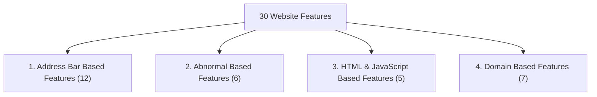

# UCI Phishing Websites Dataset (ID: 327) - Feature Dictionary & Domain Guide
**Foundations of Data Science (FDS) Assignment 3**
**Citation**: Mohammad, R., Thabtah, F., & McCluskey, L. (2015). *Phishing Websites Dataset*. UCI Machine Learning Repository. [DOI: 10.24432/C51W2X](https://doi.org/10.24432/C51W2X)

---

## Target Variable

- **Column Name**: `result`
- **Values**:
  - `1`: **Legitimate Website** (Safe, authentic site) -> **6,157 records (55.69%)**
  - `-1`: **Phishing Website** (Malicious, fraudulent site) -> **4,898 records (44.31%)**
- **Balance**: 1.26 : 1 (Well-balanced binary distribution, no severe class imbalance)

---

## Overview of 30 Heuristic Features

The 30 features extracted from websites are grouped into four primary categories:

---

### Category 1: Address Bar Based Features (12 Features)

These features inspect the URL structure and hostname syntax.

| # | Feature Name | Description | Value Encoding |
|---|---|---|---|
| 1 | `having_ip_address` | Uses an IP address (e.g. `http://192.168.0.1/login`) instead of a domain name. | `-1`: Phishing (IP used)   `1`: Legitimate (Domain name used) |
| 2 | `url_length` | Total character count of the URL. Phishers use long URLs to hide malicious paths. | `1`: Legitimate (< 54 chars)   `0`: Suspicious (54–75 chars)   `-1`: Phishing (> 75 chars) |
| 3 | `shortining_service` | URL shortening services (e.g. `bit.ly`, `tinyurl`) used to obscure real destination. | `-1`: Phishing (Shortened)   `1`: Legitimate (Standard domain) |
| 4 | `having_at_symbol` | Presence of `@` in URL. Browsers ignore everything before `@`, directing to the host after it. | `-1`: Phishing (`@` present)   `1`: Legitimate (No `@`) |
| 5 | `double_slash_redirecting` | Position of `//` in the URL. If `//` appears after the 7th character (e.g. `http://...//evil.com`). | `-1`: Phishing (`//` after position 7)   `1`: Legitimate (Standard `//`) |
| 6 | `prefix_suffix` | Presence of a hyphen `-` in the domain name (e.g. `paypal-update.com`). | `-1`: Phishing (Hyphen present)   `1`: Legitimate (No hyphen) |
| 7 | `having_sub_domain` | Number of subdomains (dots in domain). Phishers stack subdomains (e.g. `login.bank.secure.phish.com`). | `1`: Legitimate (1 dot/subdomain)   `0`: Suspicious (2 dots)   `-1`: Phishing (Multiple dots) |
| 8 | `sslfinal_state` | Evaluates HTTPS presence, issuer credibility, and certificate age. | `1`: Legitimate (HTTPS & trusted CA)   `0`: Suspicious (HTTPS but untrusted/short age)   `-1`: Phishing (No HTTPS / invalid) |
| 9 | `domain_registration_length` | Remaining domain registration duration before expiry. Phishing sites usually register for <= 1 year. | `-1`: Phishing (<= 1 year remaining)   `1`: Legitimate (> 1 year remaining) |
| 10 | `favicon` | Favicon loaded from external/different domain than the address bar domain. | `-1`: Phishing (External favicon)   `1`: Legitimate (Same domain favicon) |
| 11 | `port` | Non-standard open ports used (standard: 80 for HTTP, 443 for HTTPS, 21 for FTP, etc.). | `-1`: Phishing (Non-standard open ports)   `1`: Legitimate (Standard ports) |
| 12 | `https_token` | The string `https` embedded inside the domain name (e.g., `http://https-secure-bank.com`). | `-1`: Phishing (`https` in domain)   `1`: Legitimate (Standard protocol) |

---

### Category 2: Abnormal Based Features (6 Features)

These features check whether server request behavior and website identity are inconsistent.

| # | Feature Name | Description | Value Encoding |
|---|---|---|---|
| 13 | `request_url` | Percentage of external resources (images, scripts, audio) loaded from external domains. | `1`: Legitimate (< 22% external)   `-1`: Phishing (>= 22% external) |
| 14 | `url_of_anchor` | Anchor tags `<a>` pointing to empty anchors (`#`, `javascript:void(0)`) or external domains. | `1`: Legitimate (< 31% suspicious)   `0`: Suspicious (31%–67%)   `-1`: Phishing (> 67%) |
| 15 | `links_in_tags` | Percentage of `<meta>`, `<script>`, and `<link>` tags pointing to external domains. | `1`: Legitimate (< 17% external)   `0`: Suspicious (17%–81%)   `-1`: Phishing (> 81%) |
| 16 | `sfh` (Server Form Handler) | Action URL of HTML forms (`<form action="...">`). Empty or external handlers steal credentials. | `1`: Legitimate (Same domain handler)   `0`: Suspicious (External domain handler)   `-1`: Phishing (`about:blank` or empty) |
| 17 | `submitting_to_email` | Web page uses `mailto:` or server-side mail function to send user inputs directly via email. | `-1`: Phishing (`mailto:` present)   `1`: Legitimate (Standard POST/GET) |
| 18 | `abnormal_url` | Hostname is missing from the WHOIS response or does not match the page host. | `-1`: Phishing (Mismatch / abnormal)   `1`: Legitimate (Normal match) |

---

### Category 3: HTML and JavaScript Based Features (5 Features)

These features detect client-side manipulation techniques often used to mislead users.

| # | Feature Name | Description | Value Encoding |
|---|---|---|---|
| 19 | `redirect` | Number of HTTP redirects (301/302). Phishing sites chain redirects to bypass filters. | `0`: Legitimate (<= 1 redirect)   `1`: Phishing (>= 2-4 redirects) |
| 20 | `on_mouseover` | JavaScript `onmouseover` event alters the browser status bar URL to deceive users. | `-1`: Phishing (Status bar altered)   `1`: Legitimate (Clean status bar) |
| 21 | `rightclick` | JavaScript disables right-click context menu (`event.button==2`) to block "View Source". | `-1`: Phishing (Right click disabled)   `1`: Legitimate (Right click allowed) |
| 22 | `popupwindow` | Web page launches popup dialogs with credential input forms. | `-1`: Phishing (Credential popups)   `1`: Legitimate (Standard forms) |
| 23 | `iframe` | Web page embeds hidden or transparent `<iframe>` tags without borders. | `-1`: Phishing (Invisible iframe)   `1`: Legitimate (No hidden iframe) |

---

### Category 4: Domain Based Features (7 Features)

These features check global reputation, traffic rank, and DNS authenticity.

| # | Feature Name | Description | Value Encoding |
|---|---|---|---|
| 24 | `age_of_domain` | Age of domain since registration date from WHOIS. Phishing sites rarely survive > 6 months. | `-1`: Phishing (Age < 6 months)   `1`: Legitimate (Age >= 6 months) |
| 25 | `dnsrecord` | Domain has valid registered DNS records in official DNS databases. | `-1`: Phishing (No DNS record)   `1`: Legitimate (Valid DNS record) |
| 26 | `web_traffic` | Alexa/SimilarWeb global traffic rank. Legitimate sites have high popularity ranks. | `1`: Legitimate (Top 100,000 rank)   `0`: Suspicious (> 100,000 rank)   `-1`: Phishing (No rank or unindexed) |
| 27 | `page_rank` | Google PageRank value (0 to 1 scale indicating link authority). | `-1`: Phishing (PageRank < 0.2)   `1`: Legitimate (PageRank >= 0.2) |
| 28 | `google_index` | Whether the web page is indexed in Google search results. | `-1`: Phishing (Not indexed)   `1`: Legitimate (Indexed) |
| 29 | `links_pointing_to_page` | Number of inbound hyperlinks pointing to this web page. | `1`: Legitimate (> 2 links)   `0`: Suspicious (1–2 links)   `-1`: Phishing (0 links) |
| 30 | `statistical_report` | Host matches known malicious IP/domain lists (PhishTank, StopBadware). | `-1`: Phishing (Present in blacklist)   `1`: Legitimate (Not blacklisted) |
